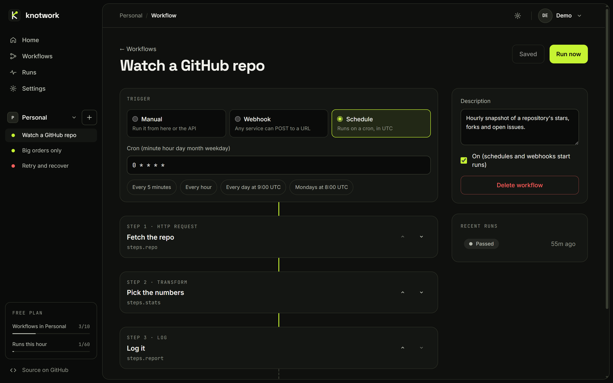
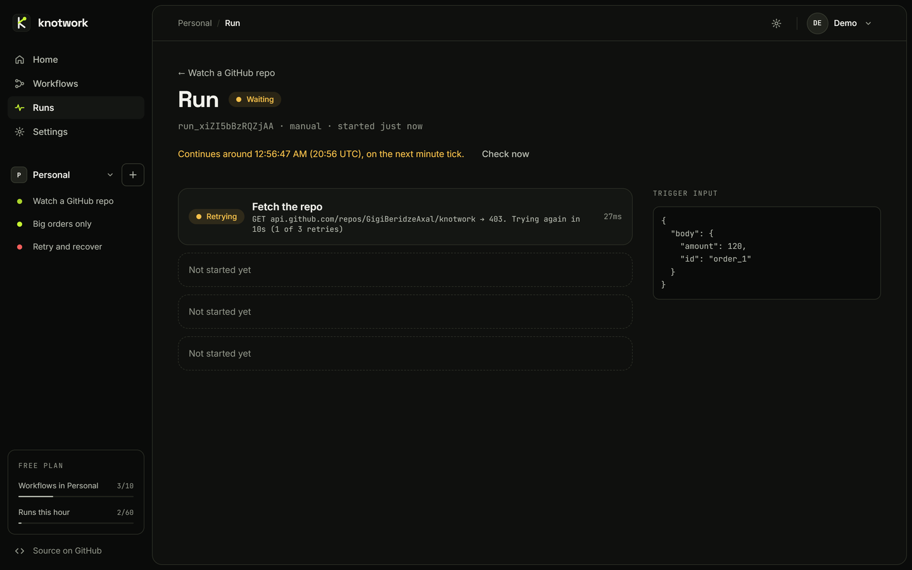

<p align="center">
  
</p>

<h1 align="center">knotwork</h1>
<p align="center"><strong>Workflows that hold.</strong><br>An open-source automation engine that runs on free plans: Cloudflare Workers and MongoDB Atlas M0.</p>

---

Knotwork wires a **trigger** (a webhook, a schedule, or a button) to a list of **steps** (HTTP calls,
transforms, filters, delays, log lines). When a step fails it waits and tries again with backoff, and every
attempt is written to a run log you can open in the dashboard.



## What it does

- **Three triggers.** A private webhook URL per workflow, a cron schedule (UTC), or a manual run with test input.
- **Five step types.** `http` calls any API, `transform` reshapes data, `filter` stops a run unless a
  condition holds, `delay` parks the run and picks it up later, and `log` writes a line.
- **Templates between steps.** Any string can use `{{ trigger.body.id }}` or `{{ steps.fetch.body.items.0.name }}`.
  A string that is only one template keeps the value's type, so arrays and numbers pass through intact.
  Templates are plain lookups: nothing is evaluated, so a workflow can't run arbitrary code.
- **Durable runs.** A run saves its place in the database after every step. Retries use exponential backoff
  (`5s → 20s → 80s`), delays can last up to a week, and a run that was cut off is picked up again by the
  next minute tick.
- **Run history.** Every attempt, a preview of its output, and how long it took. History is kept for 7 days
  after a run starts, or after it wakes from its last wait, so a long delay can't outlive its own run.
- **Accounts and workspaces.** Sign up with a name, email and password (no email to confirm), or open the
  shared **demo account** with one click. Every account starts with a **Personal** workspace and can add more;
  the sidebar switches between them, and its **+** adds a workflow to the one you're in. A workspace only ever
  sees its own workflows and runs, and a link to a workflow or run in another of your workspaces switches there.
  Settings can change your password (which logs out your other devices) or delete the account with everything in it.
- **Safe concurrent edits.** Every save carries the version it was loaded at. If someone saved in between
  (another tab, another device), you're asked to keep your version or load theirs, so nothing is lost silently.



## How it works

```
Browser ──► Cloudflare Worker ──► MongoDB Atlas (free M0 cluster)
              │  /api/auth/*  sign up, log in, demo, log out, password, delete account (session cookie)
              │  /api/*       Hono JSON API for the dashboard
              │  /hooks/*     public webhook endpoints
              │  /*           React dashboard (static assets)
              └─ cron: every minute → fire schedules, resume parked runs;
                       every 10 min check storage, hourly check indexes, daily reset the demo
```

| Part | Where |
| --- | --- |
| Engine: claims a run, runs steps, retries, parks; the cron tick | [`worker/engine.ts`](worker/engine.ts) |
| Step types, private-address and demo host checks | [`worker/steps.ts`](worker/steps.ts) |
| API and webhooks | [`worker/index.ts`](worker/index.ts) |
| Accounts: password hashing, sessions, rate-limit counters | [`worker/auth.ts`](worker/auth.ts) |
| Queries, and the limits that need the database | [`worker/db.ts`](worker/db.ts) |
| Collections, indexes and the per-request connection | [`worker/mongo.ts`](worker/mongo.ts) |
| Demo account | [`worker/demo.ts`](worker/demo.ts) |
| Workflow schema (shared by API and dashboard) | [`shared/schema.ts`](shared/schema.ts) |
| Limits | [`shared/limits.ts`](shared/limits.ts) |
| Templates and cron parser | [`shared/template.ts`](shared/template.ts), [`shared/cron.ts`](shared/cron.ts) |
| Dashboard | [`src/`](src) |

A run moves through `queued → running → (waiting →) succeeded | failed | stopped`. Before an invocation
works on a run it **claims** it with an atomic `findOneAndUpdate` and a one-minute lease, so a webhook and the
cron tick can never run the same step twice at the same time. Each step's output, log line and the run's new
position are written in one update to the run's document, and one broken run can't stop the others: it fails
on its own, and a run that keeps getting stuck is given up on after three tries.

Limits that two requests could race past are enforced atomically: run budgets and login attempts are
`$inc` counters with a time window, and a new workspace or workflow is inserted first, then counted, and
taken out again if it went over.

**Data.** Collections `users`, `sessions`, `workspaces`, `workflows`, `runs` and `counters` (rate limits).
TTL indexes delete runs after 7 days and sessions after 30 (1 for the demo), so nothing has to scan for old
data. Every 10 minutes the cron checks how much of the cluster's 512 MB is in use: past 350 MB it deletes
the oldest finished runs and stops the waiting runs of the (up to three) accounts with the most of them,
if they have more than 20; past
450 MB it pauses new runs and sign-ups until there's room again.

A Worker can't reuse a socket across requests, so each request opens one connection to Atlas when it first
needs it and closes it when it's done. The driver keeps one pooled connection and polls the cluster instead
of streaming, so a request stays within the Worker's six open sockets, and Smart Placement runs the Worker
next to the cluster to keep the handshake short. That handshake is most of a request's CPU time, close to the
free plan's 10 ms; if requests start hitting the limit, the next step is a Durable Object that keeps one
connection open.

**Accounts.** Passwords are hashed with PBKDF2-SHA-256 over an HMAC of the password keyed with `AUTH_PEPPER`,
a secret that is never stored in the database. The free plan's CPU budget allows only 10,000 iterations; the
pepper is what keeps a copy of the database alone from being used to guess passwords. The session is a random
token in an `HttpOnly`, `Secure`, `SameSite=Lax` cookie with the `__Host-` prefix; the database stores only its
SHA-256. Writes from other sites are refused, request bodies are capped at 64 KB, and Cloudflare's rate
limiter turns away more than 60 requests a minute from one IP before any database work. Webhooks are
limited per webhook URL instead (60 a minute), since services like GitHub send everyone's webhooks from a
few shared addresses, with a looser 600 a minute per IP so made-up webhook URLs can't flood the database. Sign-ups and demo
sign-ins are limited per network (IPv6 per /48) and sign-ups per day, login attempts per email and IP, and an
account keeps at most 20 sessions.

**Steps.** Everything one step renders from templates (URL, headers, body, output, message) adds up to at
most 64 KB, so naming a big value many times (`{{ trigger }}` × 1,000) fails the step instead of producing
megabytes. Log lines and errors are cut to 1 KB, and a run keeps its last 50 log lines. HTTP steps can't call `localhost` or private IP addresses (including IPv4 hidden in IPv6 forms),
every redirect is checked too, and a redirect to another origin drops credential headers. The shared demo
account's HTTP steps can only call a few public test APIs (`DEMO_HOSTS` in `worker/steps.ts`).

**Before MongoDB.** Until accounts were added, Knotwork kept its data in Cloudflare D1, with workflows tied to
a browser rather than an account. That database is left as it was and no longer used: its workflows had no
owner to move them to.

Everything fits free plans: Cloudflare Workers, static assets, cron triggers and the rate limiter, and a
MongoDB Atlas M0 cluster. It doesn't call any paid AI API.

## Run it locally

You need Node.js 22.6 or newer and a MongoDB to talk to: a free Atlas cluster, or one on your machine
(`docker run -d -p 27017:27017 mongo:8`).

```sh
npm install
# .dev.vars is gitignored. Use your Atlas string instead if you like.
printf 'MONGODB_URI=mongodb://127.0.0.1:27017\nAUTH_PEPPER=%s\n' "$(openssl rand -base64 32)" > .dev.vars
MONGODB_URI=mongodb://127.0.0.1:27017 npm run db:setup     # creates the indexes, once
npm run dev                                                # http://localhost:5173
```

`AUTH_PEPPER` must be at least 16 characters, or sign-up and login fail. The database is called `knotwork`
(`MONGODB_DB` in `wrangler.jsonc`; `db:setup` reads the same variable).

Locally every browser has the same address, so the per-network limits (5 sign-ups an hour, 30 demo sign-ins,
10 login attempts) are shared by everything you test. To start them over, empty the `counters` collection:
`docker exec <container> mongosh knotwork --eval 'db.counters.deleteMany({})'` for the Docker database,
or delete its documents in Atlas's Data Explorer.
The cron doesn't fire on its own in local development: click **Check now** on a waiting run, or run one tick
(schedules and waiting runs) with `curl http://localhost:5173/cdn-cgi/handler/scheduled`.

```sh
npm test                                              # unit tests: templates, cron, filters, auth helpers
MONGODB_TEST_URI=mongodb://127.0.0.1:27017 npm test   # also the engine and data tests, in a throwaway
                                                      # database that is dropped afterwards
npm run build                                         # type-check and build
```

## Deploy to Cloudflare

1. Create a free **M0** cluster on [MongoDB Atlas](https://cloud.mongodb.com) and a database user with only
   the `readWrite` role on the `knotwork` database and a long random password. Add the IP access list entry
   `0.0.0.0/0`: Workers have no fixed IP addresses, so that password is what protects the data.
2. Then:

```sh
npx wrangler login
MONGODB_URI="mongodb+srv://..." npm run db:setup   # indexes, once per database (add DNS_SERVERS=1.1.1.1
                                                   # if it fails with "querySrv ECONNREFUSED")
npx wrangler secret put MONGODB_URI                # paste the same connection string
npx wrangler secret put AUTH_PEPPER                # at least 16 characters; e.g. paste `openssl rand -base64 32`
npm run deploy
```

Keep a copy of `AUTH_PEPPER` outside the repo. It can't be changed later without making every existing
password stop working.

3. Add Cloudflare's free WAF rate-limiting rule for the zone (Security → WAF → Rate limiting rules): requests
   for the hostname `knotwork.gigiberidze.com` whose path starts with `/api/`, more than 10 per 10 seconds
   from one IP, block for 10 seconds. Leave `/hooks/` out, for the same shared-address reason; the Worker
   limits each webhook URL to 60 calls a minute. A person watching a run polls every 3 seconds, well under
   the rule.
   The Worker's own limiter answers floods with 429, but those requests still count toward the free plan's
   100,000 a day; the WAF rule stops them before the Worker runs. What's left is a known limit of the free
   plan: an IP that stays just under the rule (about 86,000 requests a day) uses most of the daily quota, so
   two such IPs can use all of it, as can heavy calls to webhook URLs. If that happens, `/api` and `/hooks`
   fail until 00:00 UTC while the
   dashboard's static files keep loading.

The Worker is served at `knotwork.gigiberidze.com` (the `routes` entry in `wrangler.jsonc`). Change that to your
own domain, or remove it to use the `*.workers.dev` address.

Anyone can sign up on a deployment. Webhook URLs are public; the random key in each URL is its secret.

## Limits

Because anyone can sign up, there are limits ([`shared/limits.ts`](shared/limits.ts)) that keep one
person from using up the free plans:

- 5 workspaces per account, 10 workflows per workspace and 25 steps per workflow.
- 60 runs per account per clock hour (webhooks, schedules and manual runs together); 10 in an account's
  first 24 hours. Webhook and manual runs across everyone: 3,000 an hour, and once half of that is used,
  accounts that have already started 20 this hour wait for the next. A schedule that hits its account's
  limit is skipped for that time.
- The cron moves up to 10 runs a minute (scheduled runs, and runs coming back from a delay or retry).
  Accounts take turns: those it has served least this hour go first, 2 runs each, oldest first, and spare
  slots go to busy accounts. Webhook and manual runs start in their own request.
- 100 runs per account queued or waiting (in a delay or retry) at once.
- 60 requests a minute per IP address; webhooks 60 calls a minute per URL and 600 per IP; 5 new accounts per network (IPv4 address or IPv6 /48) per hour and
  300 a day; 10 sign-ups with an email that already has an account per network per hour; 10 login
  attempts per email and IP per 15 minutes; 30 demo sign-ins per network per hour; 20 sessions per account.
- Schedules run at most every 5 minutes, in UTC.
- 32 KB per workflow and 64 KB per webhook payload or test input; 64 KB of rendered templates per step.
  HTTP calls get 15s and 256 KB of response; up to 5 retries per step; 16 KB of output is kept per step and
  64 KB per run; the last 50 log lines are kept.
- Runs are deleted 7 days after they start, or after they wake from their last wait. Workflows stay until you delete them.
- The demo account is shared by everyone who opens it, so its 60 runs an hour are shared too. Its HTTP steps
  can only call a few public test APIs, and it is reset every day at 03:00 UTC.

## Roadmap

- Inviting other people into a workspace
- Secrets per workspace, usable in templates (`{{ secrets.SLACK_URL }}`)
- Branching (if / else) and loops over arrays
- A visual canvas editor
- Signed webhooks (GitHub, Stripe) and replaying a past run

## License

MIT
